# 🍔 Flutter Food Delivery App (Sunset Diner)

A modern, responsive Flutter food delivery application featuring Firebase Authentication, interactive menus with category filtering, customizable food add-ons, dynamic cart management, animated credit card checkout, Cloud Firestore order persistence, live order tracking with receipt generation, and seamless light/dark theme switching.

---

## 📱 Screen Showcase

### 1. Authentication Flow
Secure authentication flow powered by Firebase Auth, supporting instant switching between sign-in and sign-up with real-time auth state listening via `AuthGate`.

| Login Screen | Register Screen |
| :---: | :---: |
| 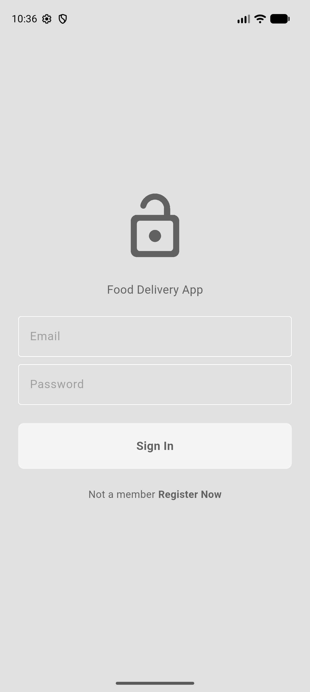 | 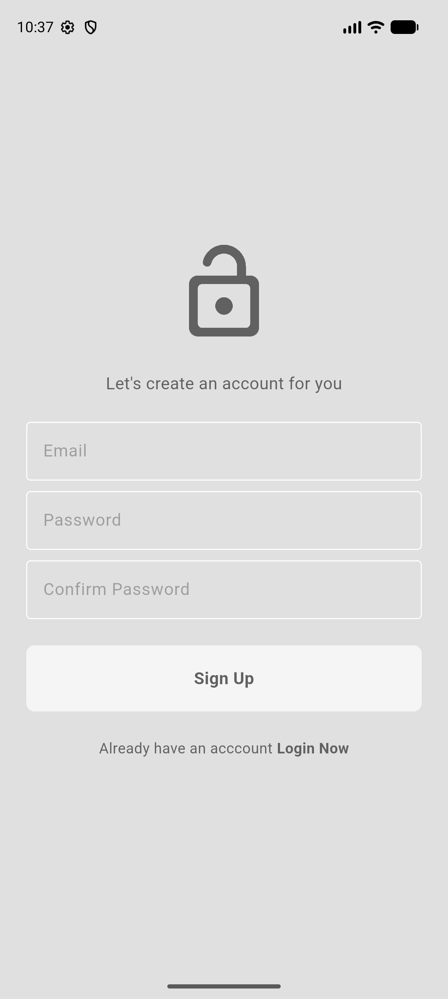 |
| **Login** (`lib/view/login_page.dart`) | **Register** (`lib/view/register_page.dart`) |

- **Login Screen**: Clean, minimalist form with email and password fields, error alert dialogs, and a one-tap link to registration.
- **Register Screen**: Account creation form with password matching validation and automatic authentication upon successful registration.

---

### 2. Menu Browsing & Navigation
Interactive food catalog with collapsible Sliver App Bar, tabbed category navigation, delivery location header, and side drawer navigation.

| Home Menu (Light Mode) | Navigation Drawer | Food Customization |
| :---: | :---: | :---: |
| 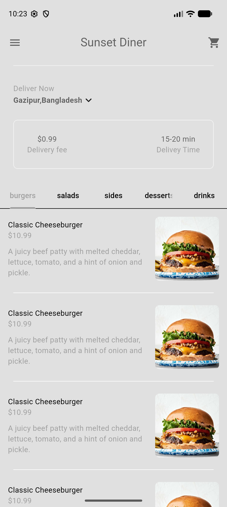 | 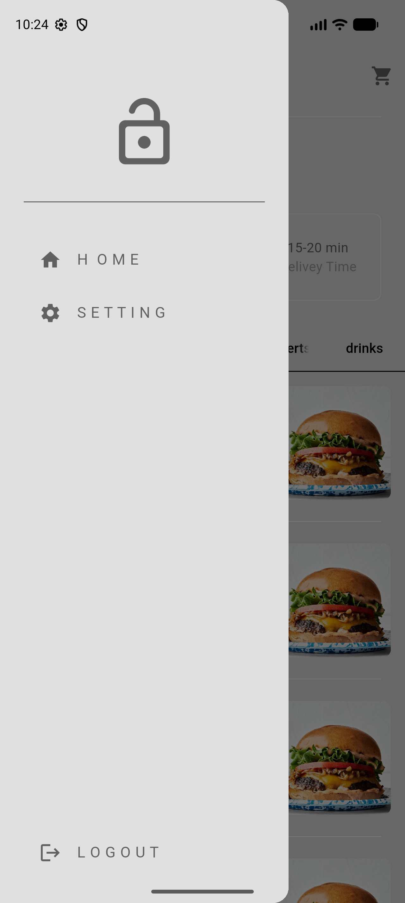 | 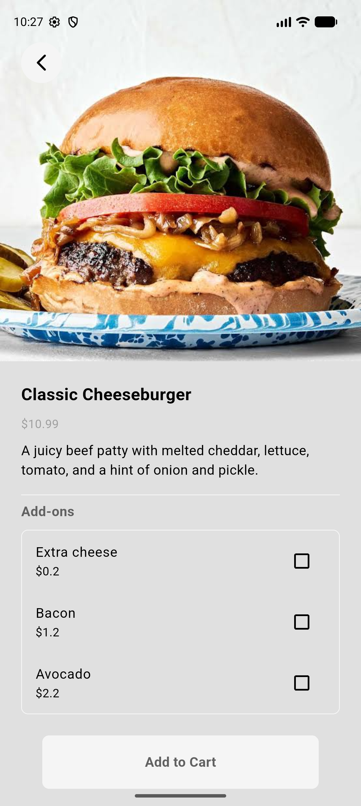 |
| **Home Page** (`lib/view/home_page.dart`) | **Drawer Menu** (`lib/components/my_drawer.dart`) | **Food Page** (`lib/view/food_page.dart`) |

- **Home Page**: Features category tabs (*Burgers, Salads, Sides, Desserts, Drinks*), estimated delivery fee & time badges, delivery address display, and rich food cards.
- **Navigation Drawer**: Quick access to Home, Settings, and Account Sign Out.
- **Food Detail & Add-ons**: High-resolution dish hero view, detailed item description, interactive multi-select add-on checkboxes with dynamic price calculations, and sticky "Add to Cart" action.

---

### 3. Cart, Checkout & Payment
Complete order lifecycle management with quantity modification, interactive credit card visualizer, and payment validation.

| Shopping Cart | Payment Form | Payment Confirmation |
| :---: | :---: | :---: |
| 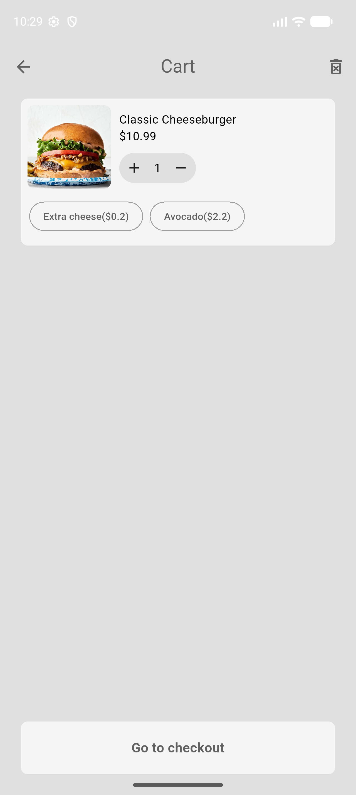 | 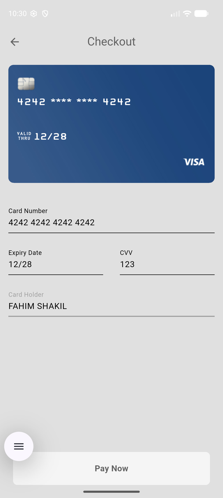 | 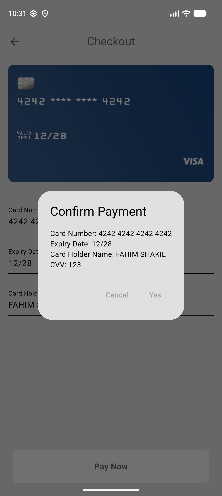 |
| **Cart** (`lib/view/cart_page.dart`) | **Checkout** (`lib/view/payment_page.dart`) | **Confirm Dialog** (`lib/view/payment_page.dart`) |

- **Shopping Cart**: Real-time cart state with item cards, chosen add-on chips, quantity increment/decrement controls, quick cart wipe dialog, and proceed to checkout action.
- **Credit Card Checkout**: Integrated `flutter_credit_card` widget with front/back card flip animation, CVV focus detection, and card brand badge.
- **Payment Confirmation Dialog**: Modal summary reviewing payment cardholder details before triggering order processing.

---

### 4. Order Tracking, Receipt & Themes
Post-checkout live delivery status, itemized receipts saved to Firestore, and complete light/dark theme customization.

| Live Delivery & Receipt | Settings (Light Mode) | Settings (Dark Mode) | Home (Dark Mode) |
| :---: | :---: | :---: | :---: |
| 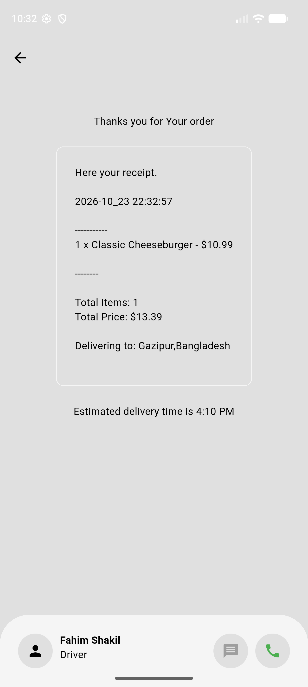 | 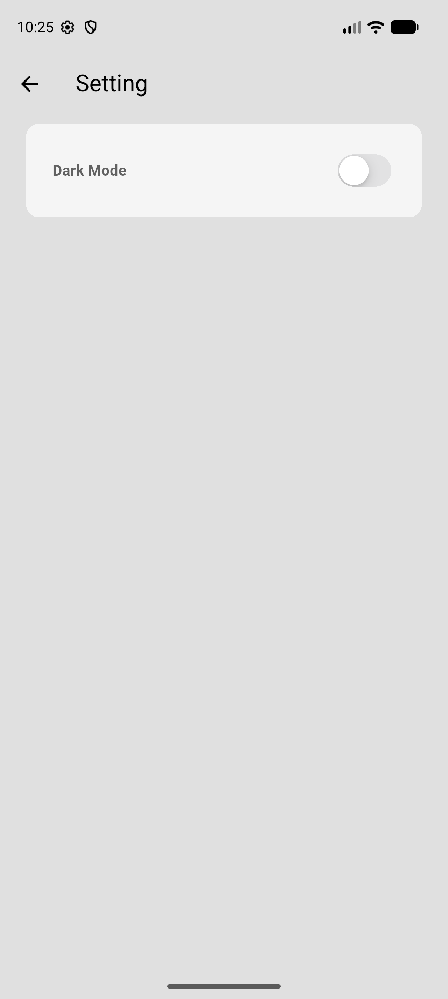 | 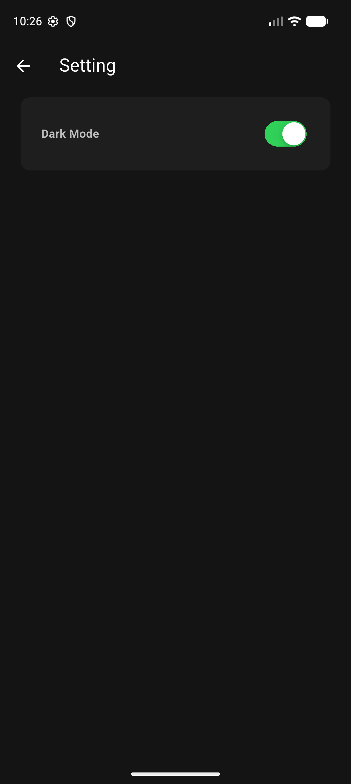 | 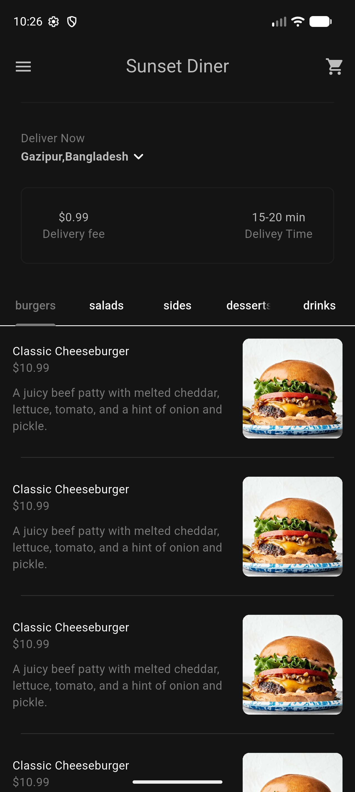 |
| **Delivery Progress** (`lib/view/delivery_progress_page.dart`) | **Settings (Light)** (`lib/view/setting_page.dart`) | **Settings (Dark)** (`lib/view/setting_page.dart`) | **Home (Dark)** (`lib/view/home_page.dart`) |

- **Delivery Progress**: Itemized, formatted receipt with exact date/timestamp, item breakdown, calculated tax and totals, estimated arrival time, and driver contact widget (call & message shortcuts).
- **Settings Screen**: Cupertino-style toggle for instant theme swapping persisted across the session via Provider.
- **Dark Mode Support**: Carefully tuned high-contrast dark theme surfaces across all components, typography, and card containers.

---

## 📑 Screen Architecture & Documentation

| Screen | File Path | Primary Functionality | State & Dependencies |
| :--- | :--- | :--- | :--- |
| **Auth Gate** | [`lib/services/auth/auth_gate.dart`](file:///d:/Programming/flutterproject/flutter_food_delivery_app/lib/services/auth/auth_gate.dart) | Listens to Firebase auth state and streams user to `HomePage` or `LoginOrRegister`. | `FirebaseAuth.authStateChanges()` |
| **Login** | [`lib/view/login_page.dart`](file:///d:/Programming/flutterproject/flutter_food_delivery_app/lib/view/login_page.dart) | User authentication via email and password with error dialog notifications. | `AuthService.signInWithEmailPassword` |
| **Register** | [`lib/view/register_page.dart`](file:///d:/Programming/flutterproject/flutter_food_delivery_app/lib/view/register_page.dart) | Account registration with password verification and validation. | `AuthService.signUpWithEmailPassword` |
| **Home** | [`lib/view/home_page.dart`](file:///d:/Programming/flutterproject/flutter_food_delivery_app/lib/view/home_page.dart) | Tab-filtered menu catalog, address selector, delivery description, and drawer access. | `Provider<Restaurant>`, `TabController` |
| **Navigation Drawer** | [`lib/components/my_drawer.dart`](file:///d:/Programming/flutterproject/flutter_food_delivery_app/lib/components/my_drawer.dart) | Side navigation panel providing routing to Home, Settings, and sign-out triggers. | `AuthService.signOut`, `Navigator` |
| **Food Details** | [`lib/view/food_page.dart`](file:///d:/Programming/flutterproject/flutter_food_delivery_app/lib/view/food_page.dart) | Detailed item view, multi-option add-on checkboxes, and quantity dispatch to cart. | `Restaurant.addToCart`, local checkbox state |
| **Shopping Cart** | [`lib/view/cart_page.dart`](file:///d:/Programming/flutterproject/flutter_food_delivery_app/lib/view/cart_page.dart) | Cart item display, add-on chips, quantity +/- adjustments, and cart reset dialog. | `Consumer<Restaurant>`, `MyQuantitySelector` |
| **Checkout & Payment** | [`lib/view/payment_page.dart`](file:///d:/Programming/flutterproject/flutter_food_delivery_app/lib/view/payment_page.dart) | Interactive credit card form with field validation and payment confirmation dialog. | `flutter_credit_card`, `GlobalKey<FormState>` |
| **Delivery Progress** | [`lib/view/delivery_progress_page.dart`](file:///d:/Programming/flutterproject/flutter_food_delivery_app/lib/view/delivery_progress_page.dart) | Receipt rendering, automatic Firestore persistence, and simulated driver communication. | `FirestoreService.saveOrderToDatabase`, `MyReceipt` |
| **Settings** | [`lib/view/setting_page.dart`](file:///d:/Programming/flutterproject/flutter_food_delivery_app/lib/view/setting_page.dart) | User preferences and dynamic Light/Dark mode toggling. | `Provider<ThemeProvider>`, `CupertinoSwitch` |

---

## 🛠️ Tech Stack & Libraries

- **Framework**: [Flutter](https://flutter.dev/) & [Dart](https://dart.dev/)
- **Backend & Database**:
  - `firebase_core`: Firebase app initialization
  - `firebase_auth`: Email/Password authentication & persistent session management
  - `cloud_firestore`: Order history and receipts persistence (`orders` collection)
- **State Management**: [Provider](https://pub.dev/packages/provider) (`ThemeProvider`, `Restaurant`)
- **UI & Layout**:
  - `flutter_screenutil`: Adaptive, responsive UI sizing across device screen factors
  - `flutter_credit_card`: Credit card rendering and interactive payment form
- **Formatting Utilities**:
  - `intl`: Date, currency, and timestamp formatting for receipts
  - `collection`: Collection equality and helper utilities

---

## 🚀 Getting Started

### Prerequisites

- Flutter SDK (3.24+ recommended)
- Dart SDK (3.5+ recommended)
- Android Studio / VS Code with Flutter extension
- Android Emulator or physical device connected
- Active Firebase Project

Check your environment:

```bash
flutter doctor
```

### 1. Clone & Install Dependencies

```bash
git clone https://github.com/FAHIMSHAKIL102/flutter_food_delivery_app.git
cd flutter_food_delivery_app
flutter pub get
```

### 2. Firebase Configuration

Ensure Firebase is configured for your target platforms:

1. Create a project in the [Firebase Console](https://console.firebase.google.com/).
2. Enable **Email/Password** authentication under *Authentication > Sign-in method*.
3. Create a **Cloud Firestore** database.
4. Run FlutterFire CLI configuration:

   ```bash
   dart pub global activate flutterfire_cli
   flutterfire configure
   ```

5. Confirm that [`lib/firebase_options.dart`](file:///d:/Programming/flutterproject/flutter_food_delivery_app/lib/firebase_options.dart) and `android/app/google-services.json` are present.

### 3. Run Application

```bash
# Check connected devices
flutter devices

# Run on your default or specific device
flutter run -d emulator-5554
```

---

## 📂 Project Directory Structure

```text
flutter_food_delivery_app/
├── android/                   # Android native configuration & Gradle scripts
├── assets/                    # Static image assets
│   └── images/                # Burgers, salads, sides, drinks, desserts
├── ios/                       # iOS native configuration & Podfile
├── lib/
│   ├── components/            # Reusable UI widgets
│   │   ├── my_button.dart
│   │   ├── my_cart_tile.dart
│   │   ├── my_current_location.dart
│   │   ├── my_description_box.dart
│   │   ├── my_drawer.dart
│   │   ├── my_drawer_tile.dart
│   │   ├── my_food_tile.dart
│   │   ├── my_quantity_selector.dart
│   │   ├── my_receipt.dart
│   │   ├── my_silver_app_bar.dart
│   │   ├── my_tab_bar.dart
│   │   └── my_textformfield.dart
│   ├── models/                # Domain models
│   │   ├── cart_item.dart
│   │   ├── food.dart
│   │   └── restaurant.dart
│   ├── services/              # Firebase & database services
│   │   ├── auth/              # AuthService, AuthGate, LoginOrRegister
│   │   └── database/          # FirestoreService (order logging)
│   ├── themes/                # App styling
│   │   ├── dark_mode.dart
│   │   ├── light_mode.dart
│   │   └── theme_provider.dart
│   ├── view/                  # Screen views
│   │   ├── cart_page.dart
│   │   ├── delivery_progress_page.dart
│   │   ├── food_page.dart
│   │   ├── home_page.dart
│   │   ├── login_page.dart
│   │   ├── payment_page.dart
│   │   ├── register_page.dart
│   │   └── setting_page.dart
│   ├── firebase_options.dart  # Generated Firebase platform options
│   └── main.dart              # App entry point & provider tree
├── screenshots/               # High-resolution screen captures for documentation
└── README.md                  # Project documentation & visual showcase
```

---

## 🧪 Testing & Validation

```bash
# Analyze Dart code for errors and warnings
flutter analyze

# Run unit and widget tests
flutter test

# Clean build cache
flutter clean
```

---

## 📄 License

This project is open-source and available for educational and portfolio demonstration purposes.
